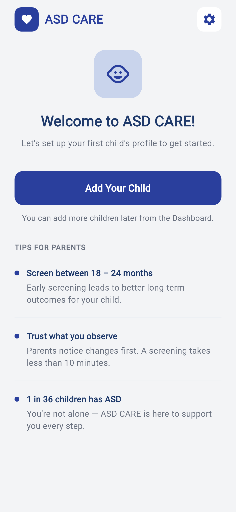
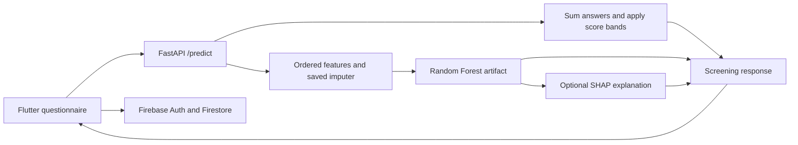

# Autism Spectrum Disorder Screening Prototype

A Flutter and Python application that combines a developmental questionnaire, child profiles, screening reports, a Random Forest model, and optional SHAP explanations.

The project demonstrates model serving and a parent/clinical review interface. Its displayed risk bands come from questionnaire score thresholds; the Random Forest prediction is returned separately.

## Mobile interface preview

The parent-focused onboarding experience introduces child profiles, early-screening guidance, and the application’s supportive care workflow.

<p align="center">
  
</p>

## Stack

| Component | Technologies |
| --- | --- |
| App | Flutter, Dart `^3.10.8`, `http` |
| Accounts and records | Firebase Authentication, Cloud Firestore |
| API | Python **3.10**, FastAPI, Pydantic, Uvicorn |
| ML | scikit-learn **1.7.2**, Joblib, pandas, NumPy, imbalanced-learn |
| Explanations | SHAP TreeExplainer |

## Architecture



The backend loads `backend/asd_risk_rf_model.joblib`, including model, imputer, and feature metadata. It can alternatively look in `ml/`; the backend copy is included. The API enforces Python 3.10 and scikit-learn 1.7.x at startup.

## Setup

```sh
git clone https://github.com/Abdul-Hadi-Jalil/Autistic-Spectrum-Disorder.git
cd Autistic-Spectrum-Disorder
```

On Windows PowerShell:

```powershell
py -3.10 -m venv backend/.venv
backend/.venv/Scripts/python -m pip install -r backend/requirements.txt
cd backend
.venv/Scripts/python -m uvicorn main:app --reload --host 0.0.0.0 --port 8000
```

On macOS/Linux, create the environment with `python3.10` and use `.venv/bin/python`. Load only the repository's trusted model artifact.

For the client, configure your Firebase project and enabled Email/Password authentication, regenerate `frontend/lib/firebase_options.dart` and matching native configuration as needed, and configure Firestore access rules for your own data.

```sh
cd frontend
flutter pub get
flutter devices
flutter run -d <device-id>
```

The client currently uses a hosted URL in `frontend/lib/services/prediction_service.dart`. To use the local backend, edit `PredictionService.baseUrl`: use `http://10.0.2.2:8000` for an Android emulator or a reachable LAN host for a phone. There is no runtime environment-variable override in that service.

## API behavior

- `GET /`: model/runtime metadata.
- `GET /health`: loaded feature count.
- `POST /predict`: screening score, separate model prediction/probabilities, optional SHAP.
- `POST /explain`: feature contributions.

Requests contain exactly 30 integer `answers`, each from 0 to 4, optional `age`, `gender`, and `relationship`, plus `include_shap`. The displayed bands are 0–30 low, 31–70 moderate, and 71–120 high. `concern_percent` is the score divided by 120; it is not an estimated probability of autism.

## Repository guide

`backend/main.py` contains validation, feature mapping, model inference, and explanations. `frontend/lib/data/` defines the developmental scale; `screens/` contains questionnaire, dashboards, consent, and report views; `services/` manages predictions and Firebase records.

## Verification and limitations

Run `flutter analyze` and `flutter test` from `frontend/`, then check local `/health` and valid/invalid questionnaire requests through `/docs`. Verify Firebase rules and user isolation in a development project before using real records.

This is a screening research prototype, not a clinically validated diagnostic tool. Score bands, model confidence, and SHAP contributions should be interpreted separately. No clinical accuracy claim is established by this documentation.
